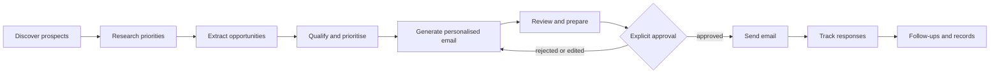

# AI Fundraising & Donor Outreach Agent

> An AI-powered system that researches potential donors and sponsors, qualifies prospects, drafts personalised fundraising emails, and sends nothing without explicit human approval.

**Author:** Tito M — AI Automation | AI Agents | Product Design | Data

> **Documentation status:** Prepared from the author's project brief. The underlying Base44 project was **not** inspected. This repository makes **no claims** that funding was secured or that any organisation responded. Capability status is tracked in [`docs/limitations-and-roadmap.md`](docs/limitations-and-roadmap.md).

---

## 1. Overview
A fundraising research and donor-engagement automation workflow. It finds funding prospects, researches their priorities, extracts opportunities, prepares personalised emails, and tracks outreach and follow-ups.

## 2. Problem Statement
Small NGOs and social ventures spend scarce time searching for donors, grants, and CSR programmes, then writing one-off emails. Funding priorities are scattered and hard to match to a cause. Mass, untargeted outreach harms credibility. This system targets relevant prospects and keeps a human accountable for every message.

## 3. Objectives
- Discover donors, NGOs, foundations, philanthropists, and CSR opportunities.
- Match prospects to relevant causes.
- Extract sponsorship and grant opportunities.
- Qualify and prioritise prospects.
- Draft personalised emails for review.
- **Require explicit approval before any email is sent.**
- Track communications, responses, and follow-ups.

## 4. Key Features
- Donor and sponsor discovery
- Funding-priority research
- Opportunity extraction
- Prospect qualification and prioritisation
- Personalised email generation
- Human-in-the-loop approval gate
- Sent/response tracking and follow-up management

## 5. Architecture

More: [`docs/architecture.md`](docs/architecture.md) · [`architecture/`](architecture/)

## 6. Workflow
Ten steps from discovery to follow-up records. See [`docs/workflow.md`](docs/workflow.md).

## 7. Technology Stack
- Base44 (AI app and agent builder)
- LLM-based research and writing (model: *unverified*)
- Email delivery (provider: *unverified*)

## 8. Integrations & Data Sources
Unverified. See [`docs/integrations.md`](docs/integrations.md).

## 9. Configuration
See [`docs/configuration.md`](docs/configuration.md) and [`.env.example`](.env.example).

## 10. Security & Responsible Outreach
No emails without explicit approval, no donor data or secrets in Git. See [`docs/security.md`](docs/security.md).

## 11. Limitations
See [`docs/limitations-and-roadmap.md`](docs/limitations-and-roadmap.md).

## 12. Roadmap
Verification against the live project, consent-aware tracking, and prospect-fit evaluation. See the roadmap document.

## 13. Author
**Tito M** — AI Automation | AI Agents | Product Design | Data
